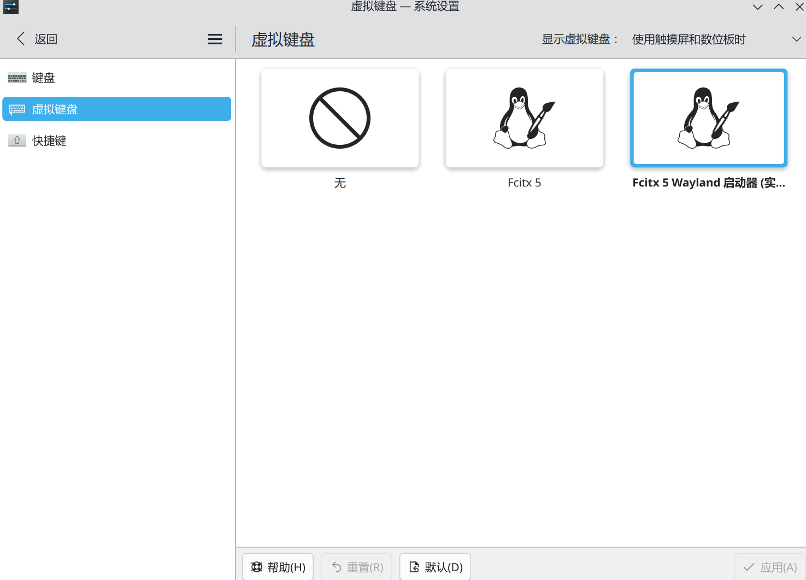

# KDE Wayland 下 Fcitx 5 的正确启动方式（虚拟键盘）

> **结论先行**：KDE Wayland 下**不要绕开 KDE 直接启动 fcitx5**（`fcitx5 -d`、autostart、systemd 用户服务拉起的实例没接入 KWin 的 Wayland 输入法前端——进程在跑、托盘有图标，但**任何输入框都切不出中文**）。正确做法：**系统设置 → 键盘 → 虚拟键盘**，在 **"Fcitx 5"** 和 **"Fcitx 5 Wayland 启动器 (实验性)"** 里**任选其一** → 应用，fcitx5 由 KWin 拉起。



## 为什么必须这样启动

- **Wayland 安全模型**：Wayland 下应用不能像 X11 那样随意全局注入按键/捕获输入。输入法必须走 `zwp_input_method_unstable_v2` 协议，而这个协议对象**只有合成器（KWin）能创建**——所以输入法进程必须由 KWin 启动，这就是"虚拟键盘"设置项的真实含义（它不只是给触摸屏用的软键盘，而是 KDE Wayland 的输入法接入口）
- **直接启动的实例是"瞎"的**：`fcitx5 -d`、autostart、`systemctl --user enable fcitx5` 起的实例只能靠 IM 模块环境变量（`GTK_IM_MODULE`/`QT_IM_MODULE`）对接应用；KDE 的 Qt 应用在 Wayland 会话下不吃这套，fcitx5 自己也会弹出提示："**Fcitx 在 KDE Wayland 应由 KWin 启动，从而使用 Wayland 输入法前端**"
- 环境变量方式只对 **XWayland 应用**有意义（保留 `XMODIFIERS=@im=fcitx` 即可），Wayland 原生应用完全依赖 input-method 协议

## 操作步骤

1. **系统设置 → 键盘 → 虚拟键盘**（见上图）
2. **"Fcitx 5"** 或 **"Fcitx 5 Wayland 启动器 (实验性)"** **任选其一**——两者都会让 KWin 以 Wayland 输入法方式拉起 fcitx5（后者是更新的专用启动器，标注实验性；实测都可用，一个不行就换另一个）。唯独不能选"无"，也不要在虚拟键盘之外手动启动 fcitx5
3. 点**应用**，立即生效（KWin 当场拉起 fcitx5，无需注销重登）

本机验证过的落点：

```bash
grep InputMethod ~/.config/kwinrc
# InputMethod[$e]=/usr/share/applications/fcitx5-wayland-launcher.desktop

pgrep -a fcitx5
# /usr/lib/fcitx5-wayland-launcher --reopen   ← KWin 经启动器拉起
# /usr/bin/fcitx5
```

输入框 `Ctrl+Space` 切换中英，能打出中文即通。配置工具：`fcitx5-configtool`（改完自动重载）；本机输入引擎为 fcitx5 + Rime。

## 常见坑

- **双实例打架**：之前配过自启动的（`~/.config/autostart/` 里有 fcitx 项、`systemctl --user is-enabled fcitx5` 非空、shell profile 里手动 exec）要先撤干净——切到虚拟键盘方式后残留实例会抢 D-Bus/配置，症状是候选框时有时无
- **不要照抄网上的环境变量教程**：全局 export `GTK_IM_MODULE=fcitx`/`QT_IM_MODULE=fcitx` 在 KDE Wayland 下不仅没必要，还可能让 XWayland 应用绕开统一通路；只保留 `XMODIFIERS=@im=fcitx`
- **`fcitx5-diagnose` 的环境变量警告可以忽略**：它是按 X11 时代标准检查的，虚拟键盘方式下这些变量大多为空是正常的
- 依赖包：`fcitx5-im` 组（fcitx5、fcitx5-configtool、fcitx5-gtk、fcitx5-qt），Rime 另装 `fcitx5-rime`

## 回退

虚拟键盘选回"无"→ KWin 立即结束 fcitx5；再按需卸载 `fcitx5-im` 组即可，配置保留在 `~/.config/fcitx5/`。
